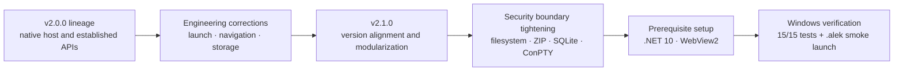
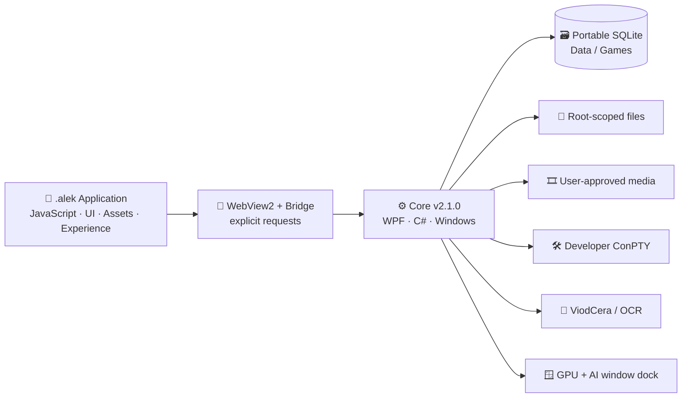
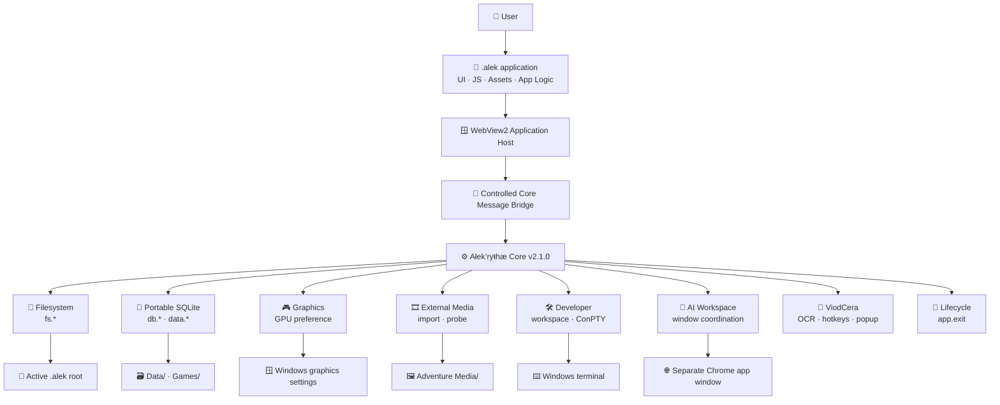
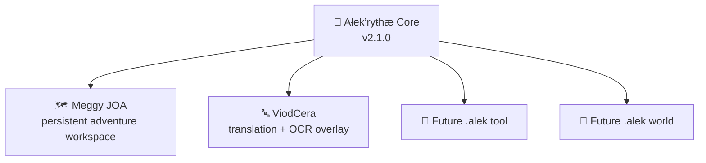

<div align="center">


# 🌌 Ałek’ryŧhæ Core

### ✦ The native heart of the `.alek` universe ✦

**Build the experience in `.alek`. Let Core handle Windows.**

A native C#/.NET 10 Windows host for portable applications, persistent worlds and carefully scoped platform services. Designed around WPF, WebView2, SQLite and an explicit application-to-host bridge.


[](#system-requirements)
[](#system-requirements)
[](#-runtime-model)
[](#-portable-data-layer)
[](#release-identity-and-current-status)
[](#validated-on-windows)
[](LICENSE)

**One Core** · **Many `.alek` applications** · **One deliberate native boundary**

[What changed in v2.1.0](#from-v200-to-v210) · [Get source & build](#source-first-download-and-build) · [Architecture](#architecture-at-a-glance) · [Capabilities](#capability-gallery) · [Security](SECURITY.md) · [License](LICENSE)

</div>

> [!NOTE]
> **v2.1.0 has now been built and launched on a real Windows 10 system.** On 15 October 2026, maintainer-provided PowerShell output showed **15/15 compatibility cases passing**, a successful **Windows x64 self-contained publish**, and creation of the local build ZIP. The maintainer also confirmed that `.alek` applications launch with the resulting Core. These are concrete smoke-test and regression results, **not** a guarantee of zero vulnerabilities, a universal clean-machine certification or an independent security audit.
>
> **Source-first distribution:** the canonical download is this GitHub repository (**Code → Download ZIP**). A source archive is **not** an installer or a ready-to-run EXE. Run `BUILD_CORE.cmd` on Windows to produce your local application files. No separate GitHub Release asset is required for this workflow.

---


## From v2.0.0 to v2.1.0

<div align="center">
<table>
<tr><th align="left">Dimension</th><th align="left">Previous v2.0.0 source</th><th align="left">Current v2.1.0 source</th></tr>
<tr><td>Startup confidence</td><td>The maintainer encountered a launch failure with the earlier distributed build</td><td>Build, 15 compatibility tests and an actual <code>.alek</code> launch have been reported successful</td></tr>
<tr><td>Developer setup</td><td>Manual environment assumptions in the build script</td><td>Detect or provision .NET 10 SDK; check WebView2 prerequisite</td></tr>
<tr><td>Native layout</td><td>Several large host/storage classes</td><td>Bridge/, Storage/, Diagnostics/ and Transfer/ responsibilities factored into dedicated modules</td></tr>
<tr><td>Testability</td><td>No Core.Compatibility runner in the supplied older ZIP</td><td>15/15 Windows regression cases, plus optional desktop probes</td></tr>
<tr><td>Persistence</td><td>Portable SQLite, atomic files and transfer existed</td><td>Improved queueing, scene services, root coordination and regression coverage</td></tr>
<tr><td>Input validation</td><td>Existing path and ZIP checks</td><td>Additional junction, archive alias, link, manifest and bounded extraction defenses</td></tr>
<tr><td>Repository discipline</td><td>Minimal security policy in the supplied ZIP</td><td>Extended SECURITY.md, structured ignore rules, hygiene script and GitHub security workflow definitions</td></tr>
</table>
</div>

This is a documented engineering comparison between the **two supplied source archives**, not a claim that every feature was absent from all earlier unpublished builds. Many capabilities, including the GPU bridge, ViodCera integration, media handling and portable data transfer, **already existed in v2.0.0**. The emphasis of v2.1.0 is reliability, structure, defensible inputs and reproducible development.

### The repair story: from source to a working host



The older build's failure was observed in the maintainer's workflow. We should neither conceal that history nor exaggerate it into a claim that **every** v2.0.0 deployment was broken. The new project's improvement is measurable: its present code **built successfully and opened `.alek` applications on the test machine**.

---

## Source-first download and build

<div align="center">

**No installer hunt. No need to locate an outdated release ZIP.**

**GitHub repository → Code → Download ZIP → Extract → BUILD_CORE.cmd → Open `.alek`**

</div>

| Step | Action | What happens |
|:--|:--|:--|
| 01 · Get | Choose **Code → Download ZIP** on the [repository homepage](https://github.com/TheDEvorger/Alekrythae-Core) | Receive the current source snapshot from the selected branch |
| 02 · Extract | Unzip into a new, writable directory | Keep tools, tests, resources and C# sources together |
| 03 · Build | Double-click `BUILD_CORE.cmd` or run it from a terminal | Prerequisite checks, dependency restore, compatibility tests and Windows x64 publish |
| 04 · Find | Open the newly generated `release/` directory | Local executable folder, ZIP and SHA-256 file |
| 05 · Open | Register Core with its EXE (no arguments), then open a trusted `.alek`, or pass the `.alek` path directly | Core hosts the application through WebView2 |

```powershell
# From the extracted repository root on Windows x64:
.\BUILD_CORE.cmd

# When the build succeeds:
explorer .\release
```

> [!TIP]
> [!CAUTION]
> GitHub may still display the **historical v2.0.0 Release** as "Latest" until a newer Release is formally published. This source-first project does **not** use that older download as the v2.1.0 installation path. For the current v2.1.0 source, use **Code → Download ZIP** from the updated main branch.

> Running `Alekrythae Core.exe` **without** a `.alek` argument performs file-association registration and exits. It is **not** a missing launcher window. To open an application directly, provide its actual path to the EXE, or use the registered `.alek` file association.

> [!IMPORTANT]
> `release/` here is a **local build-output directory**, not a requirement to publish a GitHub Release. Source downloads need .NET SDK to compile, even though the **resulting published application** is self-contained for .NET. WebView2 remains a separate dependency. The scripts check installed prerequisites and are designed to provision missing ones; the "already installed" paths were exercised in the reported Windows run. First-time download/install and restrictive enterprise environments still merit separate testing.

---

## Validated on Windows

The following snapshot is based on the **maintainer's reported console output**, not a certification by an independent test laboratory.

<div align="center">
<table>
<tr><td align="center" width="25%"><strong>15/15</strong><br/><sub>Compatibility cases passed</sub></td><td align="center" width="25%"><strong>Windows 10</strong><br/><sub>Build and smoke launch</sub></td><td align="center" width="25%"><strong>307 chars</strong><br/><sub>Long-path fixture</sub></td><td align="center" width="25%"><strong>0 issues</strong><br/><sub>Source hygiene scan</sub></td></tr>
</table>
</div>

| Evidence | Observed outcome | Scope |
|:--|:--|:--|
| Compatibility runner | `PASS 15/15` | Defined regression cases, not full exploit coverage |
| Bridge compatibility | 84 legacy/current responses equal; history count 50 | Compatibility fixture, including older R9 data |
| File access and storage | Sandbox traversal, device paths, junction exclusion, long SQLite path, atomic-failure preservation passed | Tested fixtures and their boundaries |
| Portable transfer | Round trip and hostile ZIP path/duplicate/link/undeclared-file fixtures passed | Selected adversarial inputs, not exhaustive fuzzing |
| Build | `net10.0-windows10.0.19041.0`, Windows x64 publish succeeded | Maintainer's actual Windows system |
| Prerequisites | Existing .NET 10 SDK and WebView2 were detected; no reinstall | Detection path, **not** clean-machine installation |
| Source hygiene | 100 candidate paths, 77 text files, 0 findings | Script's detection rules, **not** all potential secrets |
| Manual launch | `.alek` files opened with the newly built Core | Observed smoke-test success |

**Outstanding validation:** independent penetration review, systematic fuzz testing, clean-machine prerequisite installation, Windows 11 cross-device coverage, full desktop interaction/soak validation and code-signing are not claimed as complete. Security remains an engineering discipline, never a percentage printed on a badge.

---

## Native architecture, real responsibilities

Core combines several layers of engineering into one host, but not one inseparable source file. The native surface and portable applications are deliberately distinct.

| Layer | Modules | Primary responsibility |
|:--|:--|:--|
| Startup & host | `Program.cs`, `CosmicGate.cs`, `WebView2Prerequisite.cs` | Launch, association, WebView2 initialization, exit |
| Bridge & dispatch | `Bridge/BridgeMessage.cs`, `BridgeScript.cs`, `CosmicGate.Requests.cs`, `SerialWorkQueue.cs`, `client.js` | Translate structured app requests into supported native operations |
| Persistence | `Storage/SqliteDatabase.cs`, `GameRegistryStore.cs`, `GameDocumentStore.cs`, `GameSceneStore.cs` | Local data models, documents, scenes and revisions |
| Filesystem | `Storage/SandboxPathPolicy.cs`, `AtomicFile.cs`, `FileApiService.cs`, `RootStorageLease.cs` | Application-root path enforcement, safe writes and coordinated access |
| Portability | `DataTransferService.cs`, `Transfer/` | Snapshot-based import/export and user selection |
| Developer services | `DeveloperBridge.cs`, `ConPtySession.cs` | Approved workspaces and privileged native shell sessions |
| Integration | `GraphicsBridge.cs`, `ExternalMediaBridge.cs`, `EdgeChatGptDock.cs`, `ViodCeraBridge.cs` | GPU, media, external window coordination and OCR-related native behavior |
| Diagnostics | `Diagnostics/BufferedFileLog.cs`, test runners and probes | Bounded log output and reproducible regression checks |

### Reliability is not a single feature

The development work behind v2.1.0 addresses how requests cross the native boundary, how data is queued, how multiple windows share a root, how errors are observed, and how exit drains accepted operations. These are less visible than a colorful UI, but they determine whether an application stays usable after the first successful launch.

### Secure by policy, not immune by declaration

`.alek` files are author-created application content. Core therefore cannot treat every web-to-native request as safe merely because it belongs to an application. Supported filesystem operations are root scoped; external media follows a selected-file flow; terminal access is particularly privileged and **not an operating-system sandbox**. Read [SECURITY.md](SECURITY.md) and the [hardening notes](docs/SECURITY_HARDENING_v2.1.0_TR.md) for the threat model and remaining risks. No "100% secure" claim is made.

---

## ✧ Enter the ecosystem

<div align="center">
<table>
<tr>
<td width="33%" align="center"><strong>🌙 THE EXPERIENCE</strong><br/>A `.alek` application owns its interface, interactions, assets, lore and identity.</td>
<td width="33%" align="center"><strong>🔷 THE THRESHOLD</strong><br/>A controlled bridge translates explicitly supported requests into host operations.</td>
<td width="33%" align="center"><strong>⚙️ THE FOUNDATION</strong><br/>Windows, WPF, WebView2, SQLite, storage, media, terminals and lifecycle services.</td>
</tr>
</table>
</div>

The point of Core is not to transform every application into a monolithic native executable. The application is free to be imaginative; the host is responsible for the platform machinery. This design allows the Ałek’ryŧhæ ecosystem to add specialized applications without recoding the same Windows services in every project.

### The five-minute orientation

| You are looking for… | Start here |
|:--|:--|
| What Core does and why it exists | [The idea](#-the-idea) and [architecture](#architecture-at-a-glance) |
| Which features are native | [Capability gallery](#capability-gallery) |
| How apps communicate with Windows | [Bridge contract](#bridge-contract-and-lifecycle) |
| Where user data and worlds live | [Portable data](#-portable-data-layer) |
| How backups, imports and recovery work | [Data safety](#-data-safety--transfer) |
| How `.alek` security boundaries work | [Trust boundaries](#trust-boundaries-and-residual-risks) |
| What changed and what has actually been verified | [Revision history](#engineering-and-compatibility) |
| How to build, diagnose, release and protect the repo | [Build & test](#build-test-and-run) and [Repository hygiene](docs/REPOSITORY_HYGIENE.md) |

---

## Architecture at a glance



The diagram is architectural, not a claim that all capabilities are appropriate for every `.alek`. Particularly, the developer terminal is a privileged service and requires explicit trust review before exposing it to third-party content.

## Capability gallery

| 🧩 Service | Native responsibility | Where to inspect it |
|---|---|---|
| `.alek` launch and association | File-open flow, process registration, host startup | `Program.cs` |
| WPF + WebView2 | Embedded app surface, event routing, window lifecycle | `CosmicGate.cs` |
| Client bridge | Structured messages, promises, compatibility, bounded work queue | `Bridge/` |
| Filesystem | Root policy, text/JSON/binary reads and writes | `Storage/FileApiService.cs`, `SandboxPathPolicy.cs` |
| SQLite worlds | Registry, adventures, scenes, document revision history | `Storage/` |
| Atomic writes | Stage and replace, protect previous file on supported failures | `Storage/AtomicFile.cs` |
| `.alekdata` | Snapshot export, validation, import conflict / rollback | `DataTransferService.cs` |
| Graphics | GPU list/preferences and Windows graphics settings | `GraphicsBridge.cs` |
| External media | File picker, approved paths, import and probing | `ExternalMediaBridge.cs` |
| Developer workspace | Workspace I/O and ConPTY-backed shell API | `DeveloperBridge.cs`, `ConPtySession.cs` |
| AI visual dock | Coordinate an *external* Chrome app-mode window | `EdgeChatGptDock.cs` |
| ViodCera | Resident OCR, hotkeys, transparent selection, popups | `ViodCeraBridge.cs` |
| Clean exit / performance | Asynchronous close, storage-drain and memory pressure | `CosmicGate.cs`, `Bridge/` |

---

## Bridge contract and lifecycle

```text
[ .alek script ]
       │ structured operation + payload
       ▼
[ Bridge/client.js and WebView2 message channel ]
       │ parse • validate • correlate request ID
       ▼
[ CosmicGate request coordination ]
       │ dispatch
       ├── fs.* / db.* / data.*       → scoped persistent state
       ├── graphics / media           → native platform services
       ├── dev.*                      → privileged developer workspaces
       ├── safeAi.*                   → separate visual browser window
       └── app.exit                   → native shutdown sequence
```

A native bridge must never be confused with browser JavaScript running in an unrestricted web page. Core's navigation policy is part of the trust boundary; changes to permitted document origins must be reviewed alongside API privileges. Compatibility APIs exist for previously authored `.alek` applications, but their presence does not grant safety to unknown app content.

---

## Engineering and compatibility

The accompanying [`ENGINEERING_NOTES_TR.md`](ENGINEERING_NOTES_TR.md) records the original engineering work in Turkish. Its key themes:

- **Responsive UI:** storage work is dispatched through a bounded background queue instead of blocking the WPF thread. UI-native dialogs and browser interactions remain on their appropriate thread.
- **Orderly shutdown:** accepted storage operations drain on exit rather than depending on an unconditional short kill timer. User-interactive pickers may still hold up the close flow.
- **Shared root coordination:** windows operating on the same application data root serialize relevant storage actions; unrelated roots can progress independently.
- **Compatibility:** the development notes record legacy request formats, response envelopes, R9 database schemas and document history behavior as compatibility targets.
- **Safer persistence:** shared path restrictions include SQLite sidecars, long Unicode Windows paths, atomic staging, and failure cleanup.
- **Operational visibility:** buffered diagnostics and desktop smoke probes aid failure investigation; log queues can intentionally drop diagnostic messages under excess load.
- **Known limitations:** not every large bridge or media class has been fully decomposed; a runtime source review does not replace live Windows tests.

The engineering notes provide historical context. The current maintainer separately ran the v2.1.0 compatibility suite and build on Windows 10 on 15 October 2026; see [the verification table](#validated-on-windows).

### Source identity and historical development

| Identifier | Meaning | State in this package |
|---|---|---|
| `v2.0.0` | Earlier development baseline | Retained in historical fix reports |
| `R7` | Earlier hotfix and single-instance lineage | Historical notes retained |
| `R8` / `R9` | Navigation / startup corrections | Historical fix notes retained |
| Storage/lifecycle improvements | Updated internal service architecture | Present in submitted source |
| `v2.1.0` | Aligned source version, project, display and build metadata | **Aligned; Windows publish and manual `.alek` launch reported successful** |

The version identity is now aligned throughout the sources. A real Windows 10 compatibility run, self-contained publish and manual `.alek` launch **have since succeeded**. This evidence does **not** establish complete clean-machine support, independence of security review or universal stability.

---

## Build, test and run

### System requirements

| Runtime use | Build / development |
|---|---|
| Windows x64, Windows 10 2004+ target / Windows 11 | Windows x64 |
| **WebView2 Evergreen Runtime**, checked and provisioned when missing during `.alek` launch | **.NET 10 SDK** (automatically provisioned by `BUILD_CORE.cmd` when missing) |
| Compatible `.alek` application files | NuGet access for package restore |
| Optional Google Chrome for AI docking | Optional Node.js for JavaScript bridge checks |

The .NET release publish mode is self-contained, but **WebView2 is a separate runtime dependency**. The published Core checks for WebView2 before opening a new `.alek` window and attempts verified official installation only if it is missing. The full Release folder includes `Ensure-WebView2.ps1`; the EXE alone is not a complete distribution. A source ZIP is not a compiled portable executable. The target framework declared by the project is `net10.0-windows10.0.19041.0`.

### Fastest honest build path (Windows)

```powershell
# Open PowerShell in repository root
.\BUILD_CORE.cmd
```

The build script checks both prerequisites. It provisions the .NET 10 SDK from SHA-512-verified Microsoft release artifacts when needed; it also detects the WebView2 Evergreen Runtime and, if missing, installs it using a Microsoft Authenticode-verified Evergreen Bootstrapper. It then restores dependencies, runs compatibility tests, publishes Windows x64 and archives the result with a SHA-256 digest. It does not promise that arbitrary `.alek` apps will run successfully.

> SDK verification uses [Microsoft .NET release metadata](https://dotnetcli.blob.core.windows.net/dotnet/release-metadata/10.0/releases.json) and SHA-512. WebView2 uses [Microsoft’s Evergreen deployment guidance](https://learn.microsoft.com/microsoft-edge/webview2/concepts/distribution) plus a verified Microsoft digital signature. See [automatic prerequisite details](docs/BUILD_AUTO_PREREQUISITES_TR.md).

Or execute the individual stages:

```powershell
dotnet restore .\src\Alekrythae.Core\Alekrythae.Core.csproj
dotnet run --project .\tests\Core.Compatibility\Core.Compatibility.csproj -c Release
dotnet build .\src\Alekrythae.Core\Alekrythae.Core.csproj -c Release
node --check .\src\Alekrythae.Core\Bridge\client.js
```

> **Why not `dotnet test Alekrythae.sln`?** The submitted repository's principal compatibility suite is a **console test runner** under `tests/Core.Compatibility`, invoked using `dotnet run`. The earlier GitHub README documented a different MSTest project; copying that command blindly would not validate the current test architecture.

### Optional desktop / end-to-end verification

`tests/Core.DesktopTests` and `tools/Test-NativeCore.ps1` offer additional Windows desktop probes. They may depend on a visible desktop, an `.alek` fixture and external application assets. Read [`tests/Core.DesktopTests/README.md`](tests/Core.DesktopTests/README.md) and inspect each fixture before attempting it. Automated background CI is **not** equivalent to seeing the actual application launch, render, edit, save, exit and restart correctly.

### First launch and troubleshooting

1. Use a **new, clean release folder**. Do not overwrite an installation that owns live WebView2 data or portable worlds.
2. Confirm that `Alekrythae Core.exe`, its `.deps.json`, `.runtimeconfig.json` and all runtime dependencies exist in the published directory.
3. Confirm WebView2 is installed on Windows. Launch Core directly only for registration behavior, then open a trusted `.alek` file using its association or documented argument form.
4. If the UI is black, distinguish a missing .alek asset, failed startup navigation, WebView2 initialization failure and JavaScript exception. R8/R9 notes document an earlier generated-document navigation regression.
5. When diagnosing, preserve **sanitized** `alekrythae_webview.log` output, Windows version, WebView2 version and actual executable file version. Never post user databases, browser caches, login state or tokens.
6. Check user folders and profile backup before changing versions. See [Security Policy](SECURITY.md) and [Release Checklist](docs/SECURITY_CHECKLIST.md).

### Verify local build archive checksums

```powershell
Get-FileHash .\release\<release-zip-name>.zip -Algorithm SHA256
```

Compare the calculated digest with the locally generated companion `.sha256`. For downloads, hashes protect against accidental corruption only when the reference checksum is obtained through a trustworthy channel. A digest is **not** an executable signature or proof of safety.

---

## Trust boundaries and residual risks

| Boundary | In source | Important limitation |
|---|---|---|
| App root file / SQLite policy | Canonical-path checks, reparse-point rejection, DB sidecar checks | No OS process sandbox and potential external filesystem races |
| Host navigation | Generated app-document handshake, block other top-level navigation/new windows | Changes must be tested against startup behavior and bridge origins |
| External media | User selection and approved media path lifetime | Untrusted parsers and oversized inputs still deserve review |
| Portable backup | Snapshot, digest, conflict and rollback mechanisms | Import validation and corruption recovery still need fuzz and Windows tests |
| Dev terminal | Dedicated `dev.*` API and ConPTY | Runs native commands; **high-trust only** |
| AI browser | Separate Chrome app-mode window dock | Browser session stays external, but screen display remains sensitive |
| Repository | ignore rules, hygiene scan, CodeQL/dependency workflows | No static rule can guarantee absence of vulnerabilities or leaked historical secrets |

For reporting, triage, maintained versions, release safeguards and a fuller threat model, read the complete [SECURITY.md](SECURITY.md). The [security hardening notes](docs/SECURITY_HARDENING_v2.1.0_TR.md) document the targeted terminal, file, SQLite and archive changes. The selected compatibility fixtures now pass on the maintainer's Windows machine, while broader threat-model and installation scenarios remain open.

---

## Release identity and current status

**What changed:** the submitted `v2.1.0` source initially contained a mixture of version identifiers. The version metadata, display identity and build naming were aligned to **v2.1.0**. The source subsequently gained targeted ConPTY, file, SQLite and archive-validation hardening, automatic prerequisite checks and a PowerShell 5.1 encoding fix.

**What is demonstrated:** the maintainer later obtained a successful Windows 10 x64 publish, `PASS 15/15` compatibility tests and confirmed that `.alek` applications actually opened. In this repository-first distribution model, users build the source locally rather than relying on a separate GitHub Release asset.

**What remains open:** independent security assessment, exhaustive malicious-input testing, first-install verification on a WebView2-free clean machine, third-party systems validation and signed binary provenance. See the [maintainer checklist](docs/SECURITY_CHECKLIST.md).

---

# ✦ The idea

A `.alek` application can own its interface, assets, JavaScript, world logic, tools, lore, workflows, and user experience.

It should not have to become a Windows runtime at the same time.

**Ałek’ryŧhæ Core exists to separate those responsibilities.**

The application describes *what the experience is*.  
Core provides the native services that experience may safely request.

```text
┌───────────────────────────────────────────────────────────┐
│                    .alek application                      │
│                                                           │
│   UI · JavaScript · assets · world logic · app behavior   │
└────────────────────────────┬──────────────────────────────┘
                             │
                             │ controlled bridge
                             ▼
┌───────────────────────────────────────────────────────────┐
│                    Ałek’ryŧhæ Core                         │
│                                                           │
│  Windows · WebView2 · SQLite · Files · GPU · Media · API  │
└───────────────────────────────────────────────────────────┘
```

The result is a runtime where portable application content and native platform responsibilities can evolve without being fused into one monolith.

> **The `.alek` file is the doorway. Core is the machinery behind the door.**

---

# 🧭 Why Core exists

Desktop applications eventually collide with native concerns.

Even an application whose visible surface is built with web technology still needs answers to questions such as:

- Where does persistent data live?
- Who owns database creation and migration?
- How are files read and written without exposing the whole machine?
- How are interrupted writes handled?
- How does an app select a GPU?
- How does external media enter the application safely?
- How can a development workspace use a real Windows terminal?
- How does an application request a native exit?
- How can an AI browser window be visually integrated without turning the application into a browser credential reader?
- How can data travel between installations without blindly copying a live SQLite database?

Core is the answer layer for those questions.

Instead of making every `.alek` application reinvent platform code, Core centralizes the shared native responsibilities and exposes them through explicit bridges.

---

# ⚖️ The boundary

| The `.alek` application owns | Ałek’ryŧhæ Core owns |
|---|---|
| User experience | Native host lifecycle |
| UI and layout | WebView2 hosting |
| JavaScript application logic | Controlled native bridge |
| Assets and application resources | Root-scoped filesystem operations |
| World / tool / workflow behavior | SQLite persistence services |
| App-specific data model | Native data-transfer plumbing |
| App-specific media usage | External-media approval and probing |
| App-specific graphics UI | Windows GPU preference integration |
| App-specific developer UX | Workspace and ConPTY services |
| Exit/farewell experience | Final native process exit |
| AI workspace presentation | External window coordination |

This separation is intentional.

Core should be powerful enough to host serious applications without gradually swallowing the applications themselves.

---

# ⚡ Capability map

| Capability | What Core provides |
|---|---|
| 🌀 **`.alek` runtime** | Windows association and direct launch of `.alek` applications. |
| 🪟 **WebView2 host** | Desktop application surface backed by Microsoft Edge WebView2. |
| 🧱 **Root-scoped filesystem bridge** | File operations constrained around the active `.alek` root. |
| 💾 **Portable SQLite layer** | Registry and Adventure databases stored beside the application ecosystem. |
| ⚛️ **Atomic writes** | Same-directory temporary writes followed by atomic replacement on supported paths. |
| 📦 **`.alekdata` transfer** | Snapshot-based export/import with SHA-256 verification and rollback protection. |
| 🎮 **Graphics bridge** | Adapter discovery and persisted Windows graphics preference. |
| 🎞️ **External-media bridge** | Controlled import/probing for supported audio, video, and image formats. |
| 🛠️ **Developer bridge** | Workspace APIs plus Windows ConPTY-backed terminal sessions. |
| 🤖 **AI workspace dock** | Visual coordination of a separate Chrome application-mode window. |
| 🌙 **ViodCera bridge** | Resident hotkeys, OCR selection, translation-window support, and ViodCera lifecycle integration. |
| 💤 **Runtime power management** | Reduced WebView2 pressure while the host is inactive. |
| 🚪 **Lifecycle API** | Explicit application-to-host exit request through `app.exit`. |
| 🔁 **Compatibility work** | R9-compatible bridge responses and storage behavior under the tested compatibility contract. |

---

# 🏛️ Architecture



The architectural center is not WebView2, SQLite, or WPF by itself.

It is the **bridge contract** between portable application code and native services.

---

# 🌀 Runtime model

The normal runtime flow is intentionally small from the user's point of view:

```text
Double-click a .alek file
          │
          ▼
   Ałek’ryŧhæ Core
          │
          ▼
Resolve application root
          │
          ▼
Open WebView2 host
          │
          ▼
Expose approved Core APIs
          │
          ▼
Application becomes active
```

A `.alek` application can therefore behave like a desktop application while retaining a file-centered application identity.

When Core itself is launched without a `.alek` argument, it performs its registration work and exits instead of remaining as an unnecessary idle launcher process.

---

# 🧬 Core components

```text
src/Alekrythae.Core/
│
├── Program.cs
│   └── process lifecycle, startup and .alek association
│
├── CosmicGate.cs
│   └── primary runtime window and WebView2/Core message bridge
│
├── ViodCeraBridge.cs
│   └── ViodCera resident behavior, hotkeys, OCR and popup bridge
│
├── PortableGameStore.cs
│   └── portable SQLite persistence
│
├── DataTransferService.cs
│   └── .alekdata export, import and migration
│
├── GraphicsBridge.cs
│   └── adapter discovery and Windows graphics preference
│
├── ExternalMediaBridge.cs
│   └── approved media selection, import and probing
│
├── DeveloperBridge.cs
│   └── controlled development workspace operations
│
├── ConPtySession.cs
│   └── native Windows pseudo-terminal integration
│
├── EdgeChatGptDock.cs
│   └── external AI workspace window coordination
│
├── CoreUninstaller.cs
│   └── cleanup / uninstall workflow
│
└── Resources/
    └── icons, artwork and runtime resources
```

Each component exists for a different native responsibility.

The application should not need to know how those responsibilities are implemented internally. It should need only the bridge contract it is allowed to call.

---

# 💾 Portable Data Layer

Portability is not a slogan in Core. It is a storage decision.

A typical `.alek` root can keep runtime state close to the application:

```text
<alek-root>/
│
├── <dimension>.alek
│
├── Data/
│   └── meggy.db
│
├── Games/
│   └── <adventure>/
│       ├── game.db
│       └── Media/
│
└── application resources...
```

`PortableGameStore` deliberately avoids making the main application/game state depend on unrelated user-profile storage such as:

```text
AppData/
Documents/
Temp/
```

That gives the ecosystem a much clearer ownership model:

> **Application files belong to the application.  
> Live world data belongs beside the world.**

---

## Why portable storage matters

### 📁 Predictable ownership

A developer can understand which data belongs to which application without reverse-engineering profile folders.

### 🧳 Easier movement

The application root retains meaning when copied, archived, moved, or inspected.

### 🛟 Clearer recovery

Backups and transfer tools can target known stores instead of hunting through unrelated machine state.

### 🧬 Controlled migration

Schema and application changes can be handled through explicit migration paths.

---

# 🗃️ SQLite persistence

The Core database layer supports the persistent operations needed by compatible `.alek` applications.

Established database behavior includes workflows for:

```text
registry reads / writes
game creation
document reads / writes
existence checks
deletion
rename operations
portable database storage
```

The application defines its own domain.

Core provides the native persistence machinery beneath it.

This distinction matters because JOA, ViodCera, and future `.alek` applications do not need to share the same product logic merely because they share the same host.

---

# 🛡️ Data Safety & Transfer

Persistent worlds deserve safer write behavior than “copy the file and hope.”

Core's R6 line strengthens storage and transfer around several principles.

---

## ⚛️ Atomic filesystem writes

Supported write paths use a staged write pattern:

```text
application write request
          │
          ▼
create unique temporary file
          │
          ▼
write beside destination
          │
          ▼
replace destination atomically
          │
          ▼
clean temporary file
```

Current protected paths include supported:

```text
fs.writeText
fs.writeJson
fs.writeBinary
runtime memory writes
```

If the temporary operation fails, Core attempts to clean up the temporary artifact.

The goal is simple: reduce the probability that an interrupted operation leaves the destination half-written.

---

## 📦 `.alekdata` packages

Core's transfer layer is designed to move compatible user data without treating a live database like an ordinary static document.

Safeguards include:

- export from a consistent SQLite snapshot,
- **SHA-256** package verification,
- conflict-aware Adventure import,
- rollback package creation before import,
- compatibility handling,
- migration recognition for legacy JSON,
- SQLite source recognition,
- support for older Meggy ZIP-style sources.

```text
Live data
   │
   ├─ create consistent snapshot
   │
   ├─ package
   │
   ├─ hash / verify
   │
   └─ export
          │
          ▼
      .alekdata
          │
          ▼
   validate import
          │
   ├─ preserve rollback
   ├─ resolve conflict
   └─ activate compatible data
```

> **Move the world without gambling with the live world.**

---

# 🧱 Filesystem bridge

A desktop runtime is only useful if applications can work with files.

It is only trustworthy if “file access” does not automatically mean “the whole machine is yours.”

Core's filesystem bridge is built around the active `.alek` root.

The application requests supported operations through the bridge, and those operations are constrained to the runtime's application context.

Conceptually:

```text
C:\
├── Users\
├── Windows\
├── Other Projects\
└── My Alek App\
    ├── App.alek        ← active application
    ├── Assets\         ← application-owned
    ├── Data\           ← application-owned
    └── Games\          ← application-owned
```

The intended application surface is the final subtree, not arbitrary machine-wide navigation.

This boundary is part of the runtime architecture.

---

# 🎮 Graphics & GPU Preference

Complex WebView2 applications can be visually demanding.

`GraphicsBridge` gives `.alek` applications a native route to inspect and manage the Windows graphics preference without embedding Windows-specific graphics logic into every application.

Supported operations include:

```text
listGraphicsAdapters
setGraphicsPreference
getGraphicsPreference
openWindowsGraphicsSettings
```

The persisted preference is also used when Core builds the WebView2 browser arguments for the runtime.

This gives the application a clean division:

```text
Application
    └─ asks for graphics preference

Core
    └─ understands Windows graphics preference
```

---

# 🎞️ External Media Bridge

A persistent application may need to work with media selected from outside its own root.

Core handles that boundary through a controlled import/probe workflow.

### Audio

```text
MP3 · M4A · AAC · WAV · OGG · OPUS · FLAC · WMA
```

### Video

```text
MP4 · WEBM · MOV
```

### Image

```text
PNG · JPG/JPEG · WEBP · GIF · BMP · SVG · AVIF
```

The intended lifecycle is:

```text
external user-selected file
            │
            ▼
       Core approval
            │
            ▼
       media probing
            │
            ▼
 application-controlled import
            │
            ▼
 Adventure / Media-owned copy
```

An original arbitrary absolute source path is not intended to become a permanent world-state dependency.

That distinction keeps a portable Adventure from quietly depending on a random file that happened to exist elsewhere on one machine.

---

# 🛠️ Developer Bridge

Core is not only a player/runtime host.

R6 also exposes a dedicated `dev.*` surface for tooling and development workflows.

```text
dev.status

dev.workspace.pick
dev.workspace.release
dev.workspace.list
dev.workspace.readText
dev.workspace.writeText
dev.workspace.exists
dev.workspace.mkdir

dev.shell.start
dev.shell.write
dev.shell.resize
dev.shell.stop
```

---

## ⌨️ Native terminal sessions

Developer terminal sessions are backed by **Windows ConPTY**.

They use UTF-8 streams and support Unicode Windows paths.

That detail matters.

Ałek’ryŧhæ projects are not required to pretend the world ends at plain ASCII filenames.

```text
Workspace
   │
   ├─ controlled file API
   │
   └─ ConPTY session
          │
          ├─ start
          ├─ write
          ├─ resize
          └─ stop
```

The developer bridge is intentionally separate from the ordinary application APIs so tooling can evolve without casually widening every application's native surface.

---

# 🤖 AI Workspace Dock

Some `.alek` applications can visually integrate an external AI workspace.

Core does this by coordinating a separate **Google Chrome application-mode window**.

The browser remains its own process with its own browser profile.

Core's role is window integration:

- position,
- bounds,
- visual docking,
- lifecycle coordination.

The bridge is not designed to read:

```text
page DOM
browser cookies
saved passwords
network traffic
browser session keys
```

That is a crucial boundary.

> **Dock the window, not the user's browser identity.**

Google Chrome is optional and is only needed by applications that use this external AI-window workflow.

---

# 🌙 ViodCera Runtime Support

The v2.1.0 source line includes the native bridge required by **Alekrythae-ViodCera.alek**.

The bridge is activated only for the ViodCera application identity/file name so ordinary `.alek` applications keep their normal behavior.

ViodCera support brings a different kind of workload into the ecosystem: a resident translation/OCR utility that needs global interaction without behaving like a conventional foreground application.

---

## ViodCera native capabilities

Core provides the native side required for:

- resident hotkeys,
- selected-text translation flow,
- live OCR-region selection,
- local Windows OCR integration,
- no-activate translation popup behavior,
- ViodCera window lifecycle,
- application font scaling support,
- hidden resident operation while keeping WebView2 warm.

### Runtime controls

```text
Ctrl + Q       selected-text translation
Alt + Q        live OCR selection
Space / Enter  confirm OCR region
Esc            cancel OCR selection
Ctrl + Wheel   application font scaling
```

The OCR selection surface is designed to remain transparent rather than intentionally dimming or freezing the screen.

The ViodCera host can remain resident while hidden, allowing the WebView2 environment to stay warm for faster popup use.

---

## Why ViodCera lives behind Core

A browser UI alone cannot cleanly own global hotkeys, resident native window behavior, local Windows OCR, and no-activate popup coordination.

That is exactly the kind of boundary Core exists to handle.

```text
ViodCera.alek
     │
     │ translation / OCR UI
     ▼
WebView2 application
     │
     │ ViodCera bridge
     ▼
Ałek’ryŧhæ Core
     │
     ├─ hotkeys
     ├─ OCR selection
     ├─ native window behavior
     └─ lifecycle
```

ViodCera remains a `.alek` application.

Core remains the native host.

---

# 🚪 Application Lifecycle

Applications should not need to terminate the Core process through hacks.

The established lifecycle surface includes:

```text
app.exit
```

That allows a `.alek` application to own the user-facing exit experience first.

For example:

```text
user requests exit
      │
      ▼
application confirmation
      │
      ├─ save / animation / farewell
      │
      ▼
    app.exit
      │
      ▼
Core closes native host
```

JOA's Blue Moon exit sequence is a good example of why this separation is useful: the application controls the experience, while Core controls the actual native process lifecycle.

---

# 💤 Runtime Power Management

A desktop host should not behave as though every visual surface is foreground-critical forever.

Core includes runtime behavior intended to reduce unnecessary WebView2 memory and power pressure while an application is inactive.

The purpose is not to silently shut down application logic.

It is to make the host more respectful of machine resources when full foreground pressure is unnecessary.

---

# 🔐 Trust Boundaries

Core has access to native Windows capabilities.

That makes the boundary design more important, not less.

The runtime is built around explicit surfaces rather than a single “give the application everything” switch.

---

## Files

Application file operations are scoped around the active `.alek` root.

## Media

External paths enter through a deliberate selection/import flow.

## Browser / AI workspace

The docking layer coordinates an external browser window but is not designed as a DOM, cookie, password, traffic, or session-token extractor.

## Data transfer

Imports are validated, conflict handling exists, and rollback protection is part of the transfer workflow.

## Developer tools

Development workspace and terminal behavior live in the dedicated `dev.*` surface rather than being silently exposed as ordinary application APIs.

---

# 🧪 Runtime contract mindset

Core should be treated as a host contract.

A compatible application should depend on documented bridge behavior, not on accidental implementation details inside Core.

That means a `.alek` application should prefer:

```text
documented Core operation
```

over:

```text
assumption about Core internals
```

This is what lets the runtime evolve without requiring every application to be rewritten whenever implementation details change.

---

# 🔌 Core API Surface

The established R6 API families include:

```text
fs.*
db.*
data.*

Graphics / GPU operations
External media operations
AI operations

dev.*

app.exit
```

Individual applications may use only part of that surface.

---

## Example: JOA integration surface

Ałek’ryŧhæ · Meggy JOA uses Core services including:

```text
app.exit

fs.readText

listGraphicsAdapters
setGraphicsPreference

pickExternalMedia
probeExternalMedia

safeAi.open
safeAi.bounds
safeAi.close
```

This is the intended ecosystem pattern.

JOA does not need to *become* Core.

Core does not need to *become* JOA.

---

# 🌌 Ecosystem

Ałek’ryŧhæ Core is designed as common infrastructure beneath multiple `.alek` applications.



The runtime is shared.

The identities of the applications are not.

That is the point.

---

# 🧪 JOA Runtime Target

The v2.1.0 source line documents Core integration for:

> **Ałek’ryŧhæ · Meggy JOA v1.0.0**

JOA uses Core as its native foundation for portable storage, filesystem access, graphics integration, media workflows, SafeAI window coordination, and host lifecycle behavior.

The two projects have deliberately different responsibilities:

| JOA | Core |
|---|---|
| Adventure/world application | Native runtime |
| Mevcudat | Filesystem bridge |
| Map and travel | Portable SQLite |
| Character systems | Graphics preference |
| Tavern | Media bridge |
| Cartography | SafeAI/window integration |
| App-specific persistence model | Native persistence services |
| Blue Moon exit UX | `app.exit` host closure |

This division keeps both projects easier to reason about.

---

# 🪟 Requirements

## Runtime

- **Windows 10 version 2004 or later**
- **Windows x64**
- **Microsoft Edge WebView2 Runtime** (checked and installed on first `.alek` launch only if missing; internet needed)

Google Chrome is only required for the optional external AI workspace docking workflow.

---

## Build environment

- **Windows x64**
- **.NET 10 SDK** (auto-installed in the user profile by `BUILD_CORE.cmd` if missing)
- **Microsoft Edge WebView2 Runtime** (checked and installed when missing by `BUILD_CORE.cmd`)

---

# 📚 Main dependencies

| Package | Version | Role |
|---|---:|---|
| `Microsoft.Data.Sqlite` | `10.0.12` | Managed SQLite access |
| `SQLitePCLRaw.bundle_e_sqlite3` | `2.1.13` | SQLite native bundle |
| `Microsoft.Web.WebView2` | `1.0.4191.47` | Embedded application runtime |

---

# 🔨 Build

Clone the repository and run the supplied release build from the repository root:

```bat
BUILD_CORE.cmd
```

The build script checks .NET 10 SDK and Microsoft-signed WebView2 Runtime prerequisites, runs compatibility checks (unless `-SkipTests` is specified), publishes a self-contained Windows x64 binary, and creates a separately timestamped directory, ZIP and `.sha256` next to it. It intentionally avoids overwriting any existing installed profile:

```text
release/
├── Alekrythae-Core-v2.1.0-Windows-x64/
├── Alekrythae-Core-v2.1.0-Windows-x64.zip
└── Alekrythae-Core-v2.1.0-Windows-x64.zip.sha256
```

If the folder name is already taken the script appends a unique suffix. **This output is only produced by a successful Windows build**, not by opening the provided source ZIP.

Expected output includes:

```text
Alekrythae Core.exe
Alekrythae Core.runtimeconfig.json
Alekrythae Core.deps.json
```

For source-level performance verification followed by the normal local build:

```bat
BUILD_CORE_PERF.cmd
```

---

# ▶️ Run

Once Core has registered the `.alek` association, the normal user flow is simply:

```text
<application>.alek
      │
      │ double click
      ▼
Ałek’ryŧhæ Core
      │
      ▼
application root resolved
      │
      ▼
application opens
```

No permanent launcher needs to sit idle in the background simply to wait for an `.alek` file.

---

# 🗂️ Repository layout

The codebase is split into explicit storage, transport, bridge and diagnostics responsibilities rather than a single undifferentiated host:

```text
Alekrythae-Core/
├── .github/
│   ├── workflows/
│   │   ├── security.yml
│   │   └── dependency-review.yml
│   └── dependabot.yml
├── docs/
│   ├── RELEASE_HANDOFF_TR.md
│   ├── REPOSITORY_HYGIENE.md
│   └── SECURITY_CHECKLIST.md
├── src/Alekrythae.Core/
│   ├── Program.cs                 launch, associations, registration
│   ├── CosmicGate.cs              WPF + WebView2 host and lifecycle
│   ├── Bridge/                    message parsing, client.js, work queue
│   ├── Storage/                   sandbox, SQLite, atomic writes, stores
│   ├── Transfer/                  user file picker adapter
│   ├── Diagnostics/               bounded asynchronous logs
│   ├── DataTransferService.cs     portable import/export machinery
│   ├── DeveloperBridge.cs         dev.* workspace API
│   ├── ConPtySession.cs           native console sessions
│   ├── GraphicsBridge.cs          adapters and graphics settings
│   ├── ExternalMediaBridge.cs     media intake and probing
│   ├── EdgeChatGptDock.cs         external window coordination
│   ├── ViodCeraBridge.cs          hotkeys, OCR and popup lifecycle
│   └── Resources/                 canonical Alekrythae artwork/icons
├── tests/
│   ├── Core.Compatibility/        executable compatibility test runner
│   ├── Core.DesktopTests/         opt-in native desktop harness
│   └── *.js, *.cjs                bridge, scene and other probes
├── tools/
│   ├── Build-Core.ps1
│   ├── Test-NativeCore.ps1
│   ├── Verify-SourceHygiene.ps1
│   └── Verify-ReleaseMetadata.ps1
├── BUILD_CORE.cmd
├── BUILD_CORE_PERF.cmd
├── ENGINEERING_NOTES_TR.md
├── RELEASE_NOTES.md
├── README.md
├── SECURITY.md
├── LICENSE
├── VERSION
└── .gitignore
```

All source graphics such as `Resources/Alekrythae.png`, `Bluemoon.png`, `Adventurer.png` and icons are intentionally retained. User profiles, generated releases and local state are not.

---

# 🧹 Repository Hygiene

A runtime repository should not become a scrapbook of machine-local state.

Keep material such as the following out of source control:

```text
.env
private keys
credential files
browser profiles
session tokens

runtime databases
WAL / SHM state
temporary exports
logs
build caches
machine-local paths
```

Source code, runtime contracts, and intentional resources belong in the repository.

User state does not.

---

# 🧬 Versioning

Ałek’ryŧhæ Core uses **one public version identity**. `VERSION`, C# project metadata, Windows display labels and local build output must agree. A GitHub tag is optional for a source-first distribution; if a maintainer creates one, it should use the same version.

```text
Release version : v2.1.0
Assembly label  : 2.1.0
Package name    : Alekrythae-Core-v2.1.0-Windows-x64
```

Version identifiers follow `vMAJOR.MINOR.PATCH`. Internal engineering notes are historical documents, **not part of the public application name**. The current version has been built and smoke tested on Windows; users downloading new commits should still test their own compiled result.

---

# 🏁 v2.1.0 · verified source-build baseline

This repository declares **v2.1.0** as its source and binary build identity. The maintainer's current Windows 10 build and `.alek` launch have succeeded; individual builds from the source still depend on their local environment and should be verified.

It brings the established Core architecture together as the native foundation for the modern `.alek` ecosystem.

### Core runtime foundations

- `.alek` file association and launch flow
- WebView2 desktop host
- root-scoped filesystem bridge
- portable SQLite persistence
- atomic write protection
- `.alekdata` transfer safeguards
- graphics-adapter discovery
- Windows graphics preference integration
- external media import/probing
- developer workspace bridge
- Windows ConPTY terminal integration
- external AI workspace docking
- runtime power-management behavior
- native lifecycle APIs

### v2.1.0 source ecosystem support

- **Ałek’ryŧhæ · Meggy JOA v1.0.0** target runtime
- **ViodCera** native hotkey/OCR/window bridge
- R9 regression and compatibility coverage described in the engineering notes
- `v2.1.0` identity with successful maintainer Windows 10 compilation, 15/15 compatibility tests and `.alek` smoke launch

---

# 🧭 Design Philosophy

## 1 · Native power should have a boundary

Running on desktop should not mean application code receives unrestricted machine access by default.

---

## 2 · Portable data should actually be portable

A world is not portable when its important state is invisibly scattered across unrelated profile folders.

---

## 3 · Safety belongs below the application

Atomic writes, controlled import, scoped paths, and native lifecycle behavior are stronger when the host enforces them consistently.

---

## 4 · Core should not become every application

JOA should remain JOA.

ViodCera should remain ViodCera.

Future `.alek` applications should be free to develop their own identity.

Core exists to give them native capabilities without absorbing them.

---

## 5 · Compatibility is part of the product

A runtime becomes useful when applications can rely on its contracts.

Stable namespaces and clear boundaries matter as much as features.

---

## 6 · Native complexity should be paid once

If ten `.alek` applications require the same Windows capability, the ecosystem should not need ten unrelated implementations of that capability.

Core is where shared native complexity belongs.

---


# 🔎 Build integrity and disclosure

The repository contains source, build tooling and test definitions. **Source distribution and runnable binary distribution are intentionally different.** The local `BUILD_CORE.cmd` workflow creates a Windows application bundle and a SHA-256 digest for that bundle, but it does not transform the source ZIP into a precompiled installer.

For anyone evaluating this project:

| Question | Answer |
|---|---|
| Is the source publicly readable? | Yes, on this repository. |
| Is it OSI-approved open source? | **No.** The repository uses the separate proprietary [TheDEvorger UPSL v1.3](LICENSE). |
| Do the Windows compatibility tests pass? | The maintainer reported **15/15** on Windows 10 for this source baseline. |
| Is the generated EXE code signed? | No signed-binary guarantee is offered here. |
| Does a successful hygiene scan certify zero vulnerabilities? | No; it checks specified source hygiene rules only. |
| Must users fetch a GitHub Release to build? | No; **Code → Download ZIP** is the documented source-first path. |
| Is the developer terminal a secure OS sandbox? | No; it remains a privileged native capability. |
| Is a first-time clean-machine installation fully verified? | Not yet. |

### Maintainer's responsible publishing checklist

- Confirm the published `main` branch contains the tested source tree, including `tools/`, `tests/` and canonical `Resources/` artwork.
- Run the source hygiene check and review `git status` before a push; ignored files can still exist in previously tracked Git history.
- Run `BUILD_CORE.cmd`, review compatibility results, then manually open a trusted `.alek` with the newly generated Core.
- Keep [`SECURITY.md`](SECURITY.md) and the private report address available. Review dependency and CodeQL results when GitHub Actions executes.
- Keep generated `release/`, WebView2 profiles, SQLite databases, logs and private keys outside source control.
- Record significant changes in `RELEASE_NOTES.md` or changelogs without claiming tests that have not been performed.

---

# ❓ FAQ

<details>
<summary><strong>What exactly is a <code>.alek</code> application?</strong></summary>

A `.alek` application is an application package/entry point hosted by Ałek’ryŧhæ Core. The application owns its UI, JavaScript, assets, behavior, and domain logic, while Core provides the approved native Windows services it needs.

</details>

<details>
<summary><strong>Is Ałek’ryŧhæ Core itself JOA?</strong></summary>

No. JOA is one `.alek` application in the ecosystem. Core is the runtime beneath it.

</details>

<details>
<summary><strong>Is ViodCera built into every application?</strong></summary>

No. Core contains ViodCera-specific native bridge support, but that bridge is activated only for the ViodCera application identity/file name. Normal `.alek` behavior remains unchanged.

</details>

<details>
<summary><strong>Where does application data live?</strong></summary>

The portable model keeps runtime stores such as `Data/` and `Games/` beside the active `.alek` root rather than making application state depend on unrelated profile directories.

</details>

<details>
<summary><strong>Does the AI workspace dock read browser passwords or cookies?</strong></summary>

The docking layer is designed for window placement and lifecycle integration. It is not designed to read page DOM, cookies, passwords, network traffic, or browser session keys.

</details>

<details>
<summary><strong>Why use SQLite?</strong></summary>

SQLite gives compatible `.alek` applications a compact local persistent store while fitting Core's portable-file model.

</details>

<details>
<summary><strong>Does an application get unrestricted access to Windows files?</strong></summary>

The Core filesystem bridge is designed around the active `.alek` root rather than an unrestricted machine-wide filesystem surface.

</details>

<details>
<summary><strong>What version should I use when reporting an issue?</strong></summary>

Use `v2.1.0` and the GitHub commit hash for precise diagnostics. Internal historical engineering reports do not change the public version.

</details>

<details>
<summary><strong>What happens when Core is opened without a .alek file?</strong></summary>

Core performs its registration work and exits instead of remaining as an idle background launcher.

</details>

<details>
<summary><strong>Can developer tools use a real terminal?</strong></summary>

Yes. The developer bridge provides terminal sessions backed by Windows ConPTY with UTF-8 streams and Unicode-path support.

</details>

---

# 🌠 The ecosystem direction

Ałek’ryŧhæ Core is not intended to end as a launcher for one project.

Its architecture points toward an ecosystem where specialized applications can share a reliable native foundation:

```text
                         🌌
                 Ałek’ryŧhæ Core
                      v2.1.0
                         │
          ┌──────────────┼──────────────┐
          │              │              │
          ▼              ▼              ▼
      Meggy JOA       ViodCera      Future .alek
       worlds        translation       tools
          │              │              │
          └──────────────┼──────────────┘
                         │
               controlled native APIs
                         │
             portable application roots
```

The applications can change.

The worlds can change.

The interfaces can change.

The native boundary remains something they can build upon.

---

<div align="center">

<br>

# 🌙 Ałek’ryŧhæ Core

### **Build the experience in `.alek`. Keep the native machinery in Core.**

<br>

`v2.1.0` · `.NET 10` · `WPF` · `WebView2` · `SQLite` · `Windows x64`

<br>

### **One Core. Many `.alek` applications. One evolving software ecosystem.**

</div>

---
© 2026 TheDEvorger. All rights reserved.

Ałek’ryŧhæ Core and the Ałek’ryŧhæ ecosystem are protected works of TheDEvorger.

Use, modification, redistribution, and commercial exploitation are subject to authorization by the copyright holder and any terms explicitly published with the repository.

**Licensing & Legal:**  
thedevorger.alekrythae.dev@gmail.com  

Full terms: [LICENSE](LICENSE) (TheDEvorger UPSL v1.3).
